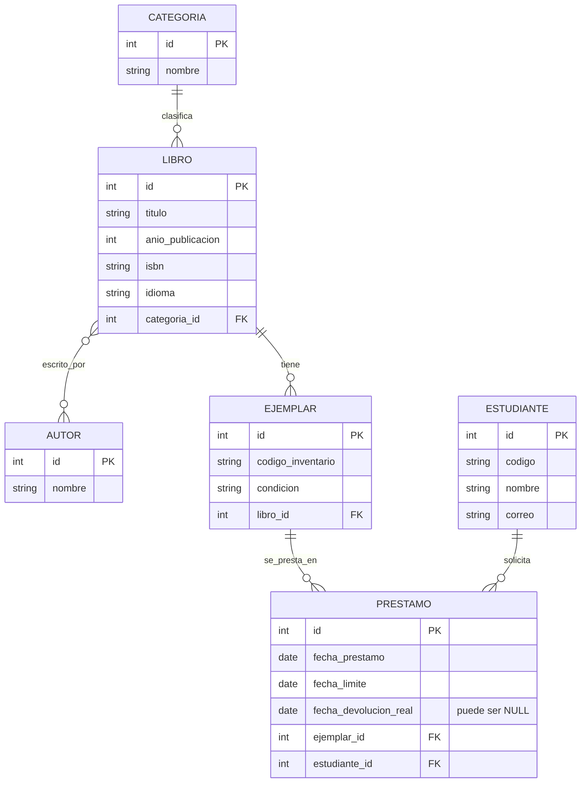
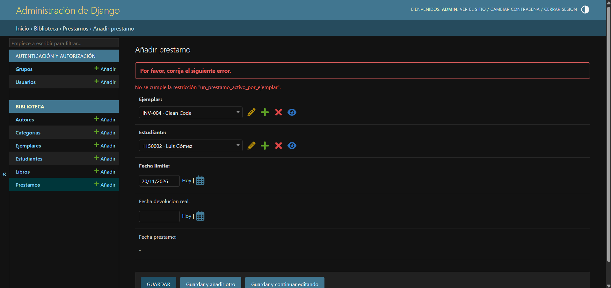

# Biblioteca UFPS

Sistema de gestión de préstamos para la biblioteca de la universidad, hecho con Django. Reemplaza los cuadernos de la bibliotecaria: registra libros, copias físicas, estudiantes y préstamos, y permite saber qué copias están prestadas y quién las tiene.

Proyecto de la actividad «Biblioteca con Django»: modelos, migraciones, panel de administración y consultas con el ORM.

## 2. Tecnologías

- Python 3.12 o superior
- Django (la versión exacta está en `requirements.txt`)
- SQLite: archivo local `db.sqlite3`, que **no** se sube al repositorio
- Mermaid, para el diagrama de relaciones

## 3. Instalación y ejecución

```bash
git clone https://github.com/Camilo503/biblioteca-ufps.git
cd biblioteca-ufps
python -m venv .venv
```

Activar el entorno virtual (según el sistema):

| Sistema | Comando |
|---|---|
| Windows PowerShell | `.venv\Scripts\Activate.ps1` |
| Windows CMD | `.venv\Scripts\activate.bat` |
| macOS / Linux | `source .venv/bin/activate` |

Con el entorno activo (el prompt empieza con `(.venv)`):

```bash
python -m pip install -r requirements.txt
python manage.py migrate
python manage.py createsuperuser
python manage.py shell -c "exec(open('scripts/seed.py', encoding='utf-8').read(), {})"
python manage.py runserver
```

- `createsuperuser` crea el usuario administrador de **tu** copia local (usuario y contraseña a tu elección; no se suben a ningún sitio).
- El comando del `seed` carga datos de prueba y se ejecuta **una sola vez** por base de datos.
- Abrir http://127.0.0.1:8000/admin/ e iniciar sesión con el superusuario.

## 4. Estructura del proyecto

```
biblioteca-ufps/
├── manage.py                # punto de entrada de todos los comandos de Django
├── requirements.txt         # dependencias exactas, para reproducir el entorno
├── .gitignore               # excluye .venv, db.sqlite3 y cachés
├── config/                  # configuración del proyecto
│   ├── settings.py          # ajustes (apps instaladas, idioma, zona horaria)
│   └── urls.py              # rutas raíz (incluye /admin/)
├── biblioteca/              # la app
│   ├── models.py            # los 6 modelos y la regla del préstamo
│   ├── admin.py             # personalización del panel de administración
│   └── migrations/          # historia de la base de datos (0001 y 0002)
├── scripts/
│   └── seed.py              # crea datos de prueba
└── docs/                    # respuestas de la Fase 1, diseño y resultados de los retos
```

## 5. Modelo de datos

<!-- A completa esta sección (evidencia de la regla) -->



### Las relaciones, una por una

- **Categoría → Libro (uno a muchos):** una categoría clasifica muchos libros; cada libro pertenece a una sola categoría.
- **Libro ↔ Autor (muchos a muchos):** un libro puede tener varios autores y un autor puede haber escrito varios libros. Django crea la tabla intermedia `biblioteca_libro_autores`.
- **Libro → Ejemplar (uno a muchos):** un libro tiene muchas copias físicas; cada copia es de un solo libro.
- **Ejemplar → Préstamo (uno a muchos):** una copia se presta muchas veces a lo largo del tiempo; cada préstamo es de una sola copia.
- **Estudiante → Préstamo (uno a muchos):** un estudiante solicita muchos préstamos; cada préstamo es de un solo estudiante.

### Decisiones de diseño

- **Libro y Ejemplar son modelos distintos.** El libro es la obra (título, ISBN, autores, categoría); el ejemplar es una copia física con su propio código de inventario y condición. Si fueran un solo modelo, tres copias del mismo libro obligarían a repetir título, ISBN y autores tres veces, a corregir cada dato tres veces, y no habría forma limpia de saber qué copia está prestada.
- **`fecha_devolucion_real` es `null=True, blank=True`.** Mientras el libro sigue prestado vale `NULL`. Esa es la definición de «préstamo activo».
- **`on_delete=PROTECT` en las ForeignKey.** No se puede borrar una categoría con libros, un libro con copias, ni un estudiante o una copia con préstamos. Así no se pierde el historial de la biblioteca.
- **`unique=True`** en ISBN, código de inventario, código de estudiante y nombre de categoría, porque son identificadores que no pueden repetirse.

### Regla de la copia prestada

> Una copia física no puede estar en dos préstamos sin devolver al mismo tiempo.

La implementamos con **constraints** (una restricción de unicidad condicional en `Prestamo.Meta`) y no con `clean()`:

```python
models.UniqueConstraint(
    fields=["ejemplar"],
    condition=Q(fecha_devolucion_real__isnull=True),
    name="un_prestamo_activo_por_ejemplar",
)
```

Se lee así: el campo `ejemplar` debe ser único, pero solo entre los préstamos cuya `fecha_devolucion_real` es `NULL`. Por eso no puede haber dos préstamos activos de la misma copia, pero sí muchos préstamos viejos ya devueltos.

**Por qué constraints y no `clean()`:** `clean()` solo corre cuando se valida un formulario (por ejemplo, en el admin); **no** se ejecuta con `.save()` desde el shell ni desde otro código. La restricción la hace cumplir la propia base de datos, siempre. Además cubre el caso de dos usuarios guardando a la vez, que `clean()` no evita.

**Prueba de que funciona** (se creó un préstamo de una copia y se intentó crear un segundo sin devolver el primero):

```
django.db.utils.IntegrityError: UNIQUE constraint failed: biblioteca_prestamo.ejemplar_id
```

Y al marcar el primer préstamo como devuelto, el segundo sí se pudo crear: la regla no bloquea el historial.

### Migraciones

- `0001_initial`: crea los 6 modelos. Con `python manage.py sqlmigrate biblioteca 0001` se ve el SQL: una tabla por modelo (`biblioteca_libro`, `biblioteca_prestamo`, …), la tabla intermedia `biblioteca_libro_autores` y un índice único parcial para la regla del préstamo.
- `0002_libro_idioma`: agrega el campo `idioma` a `Libro`. Al principio lo definimos sin `default`, y Django preguntó qué valor poner a los libros que ya existían, porque la columna nueva no admite vacío. Resolvimos agregando `default="Español"`.

## 6. Panel de administración

<!-- A completa la captura -->

| Personalización | Qué necesidad de la bibliotecaria resuelve |
|---|---|
| `search_fields` en Estudiante (código y nombre) y en Préstamo | Encontrar a un estudiante y sus préstamos escribiendo su código o su nombre |
| Columna «¿Sin devolver?» (icono verde/rojo) en Préstamo | Ver de un vistazo qué préstamos siguen pendientes |
| `list_filter` por fecha de devolución y fecha límite | Filtrar por «sin devolver» o por vencidos |
| `autocomplete_fields` para ejemplar y estudiante | Elegir la copia correcta buscando por código de inventario o título, sin confundir copias del mismo libro |
| `EjemplarInline` dentro de Libro | Registrar o editar las copias físicas desde la propia ficha del libro |
| `readonly_fields = ("fecha_prestamo",)` | La fecha de préstamo se pone sola y nadie la altera por error |
| Acción «Marcar préstamos seleccionados como devueltos» | Registrar varias devoluciones de una sola vez |
| `list_display` y `list_filter` en Libro, Ejemplar y Estudiante | Ver las columnas importantes y filtrar por categoría, año o condición |

El admin también rechaza un segundo préstamo activo de la misma copia, con un mensaje claro en el formulario («No se cumple la restricción "un_prestamo_activo_por_ejemplar"»):



## 7. Consultas del ORM

<!-- B completa predicción, resultado y comparación de cada reto -->

Todas se ejecutaron en `python manage.py shell` sobre la base creada con `scripts/seed.py`. En cada una escribimos primero la predicción, luego la ejecutamos y comparamos.

Imports usados:

```python
from django.db.models import Count, Q
from datetime import date
from biblioteca.models import *
```

### Reto 1 · Crear un autor, un libro suyo y dos copias

```python
a = Autor.objects.create(nombre="Autor Nuevo")
l = Libro.objects.create(titulo="Libro Nuevo", anio_publicacion=2020,
                         isbn="9999999999999", categoria=Categoria.objects.first())
l.autores.add(a)
Ejemplar.objects.create(libro=l, codigo_inventario="INV-100")
Ejemplar.objects.create(libro=l, codigo_inventario="INV-101")
```

El libro necesita una categoría (ForeignKey obligatoria) y los autores se agregan después de crearlo, porque el muchos a muchos usa una tabla aparte.

- **Predicción:** COMPLETAR
- **Resultado:** COMPLETAR
- **¿Coincidió?** COMPLETAR

### Reto 2 · Libros de un autor, buscando al autor por su nombre

```python
Libro.objects.filter(autores__nombre="Robert C. Martin")
```

El doble guion bajo atraviesa la relación: «los libros cuyo autor tiene ese nombre».

- **Predicción:** COMPLETAR
- **Resultado:** COMPLETAR
- **¿Coincidió?** COMPLETAR

### Reto 3 · Libros cuyo título contiene una palabra, sin importar mayúsculas

```python
Libro.objects.filter(titulo__icontains="clean")
```

`icontains` es «contiene, ignorando mayúsculas».

- **Predicción:** COMPLETAR
- **Resultado:** COMPLETAR
- **¿Coincidió?** COMPLETAR

### Reto 4 · Copias disponibles (sin ningún préstamo activo)

```python
Ejemplar.objects.exclude(prestamos__fecha_devolucion_real__isnull=True)
```

Se lee: «todas las copias, excepto las que tienen algún préstamo con fecha de devolución vacía». Un `filter(prestamos__fecha_devolucion_real__isnull=False)` parece equivalente, pero no lo es: solo devolvería las copias que alguna vez se prestaron y se devolvieron, y dejaría fuera las que nunca se han prestado.

- **Predicción:** COMPLETAR
- **Resultado:** COMPLETAR
- **¿Coincidió?** COMPLETAR

### Reto 5 · Estudiantes con al menos un préstamo activo, sin repetir

```python
Estudiante.objects.filter(prestamos__fecha_devolucion_real__isnull=True).distinct()
```

Sin `.distinct()`, un estudiante con dos préstamos activos aparecería dos veces, porque la consulta cruza la relación y devuelve una fila por préstamo.

- **Predicción:** COMPLETAR
- **Resultado:** COMPLETAR
- **¿Coincidió?** COMPLETAR

### Reto 6 · Cuántos préstamos ha hecho cada estudiante

```python
for e in Estudiante.objects.annotate(total=Count("prestamos")):
    print(e.nombre, e.total)
```

`annotate` agrega a cada estudiante un valor calculado (`total`), contando todos sus préstamos, devueltos o no.

- **Predicción:** COMPLETAR
- **Resultado:** COMPLETAR
- **¿Coincidió?** COMPLETAR

### Reto 7 · El libro más prestado

```python
Libro.objects.annotate(total=Count("ejemplares__prestamos")).order_by("-total").first()
```

El camino es Libro → ejemplares → préstamos. El `-` delante de `total` ordena de mayor a menor y `first()` toma el primero.

- **Predicción:** COMPLETAR
- **Resultado:** COMPLETAR
- **¿Coincidió?** COMPLETAR

### Reto 8 · Estudiantes que nunca han pedido un préstamo

```python
Estudiante.objects.filter(prestamos__isnull=True)
```

- **Predicción:** COMPLETAR
- **Resultado:** COMPLETAR
- **¿Coincidió?** COMPLETAR

### Reto 9 · Marcar un préstamo como devuelto con la fecha de hoy y comprobarlo

```python
p = Prestamo.objects.filter(fecha_devolucion_real__isnull=True).first()
p.fecha_devolucion_real = date.today()
p.save()
Prestamo.objects.get(pk=p.pk).fecha_devolucion_real
```

La comprobación vuelve a leer el registro desde la base (`get`), porque mirar la variable `p` solo demostraría que el objeto en memoria cambió.

- **Predicción:** COMPLETAR
- **Resultado:** COMPLETAR
- **¿Coincidió?** COMPLETAR

### Reto 10 · Borrar un autor y observar qué pasa con sus libros

```python
autor = Autor.objects.get(nombre="Gabriel García Márquez")
autor.delete()
Libro.objects.filter(titulo__icontains="soledad").exists()
```

Libro y Autor se relacionan con `ManyToManyField`, que se implementa con una tabla intermedia y **no** lleva `on_delete`. Al borrar el autor solo se eliminan las filas de la tabla intermedia que lo mencionan; los libros siguen existiendo, ahora con un autor menos. El `on_delete=PROTECT` que sí usamos actúa en las ForeignKey: por ejemplo, impediría borrar una categoría mientras tenga libros.

- **Predicción:** COMPLETAR
- **Resultado:** COMPLETAR
- **¿Coincidió?** COMPLETAR

## 8. Optimización

<!-- B completa los números -->

El problema N+1: al recorrer una lista y acceder en cada elemento a un objeto relacionado, Django hace 1 consulta para la lista y 1 más por cada elemento. Con pocos datos no se nota; con miles, la página se vuelve lenta. Medimos las consultas con `CaptureQueriesContext`.

### Caso 1: préstamos con su estudiante y su libro

```python
# Antes
for p in Prestamo.objects.all():
    print(p.estudiante.nombre, p.ejemplar.libro.titulo)

# Después
for p in Prestamo.objects.select_related("estudiante", "ejemplar__libro"):
    print(p.estudiante.nombre, p.ejemplar.libro.titulo)
```

`select_related` trae el objeto relacionado en la misma consulta con un JOIN, y se encadena (`ejemplar__libro`).

### Caso 2: libros con la lista de sus autores

```python
# Antes
for l in Libro.objects.all():
    print(l.titulo, [a.nombre for a in l.autores.all()])

# Después
for l in Libro.objects.prefetch_related("autores"):
    print(l.titulo, [a.nombre for a in l.autores.all()])
```

### Resultados

| Consulta | Predicción (antes) | Antes | Después |
|---|---|---|---|
| Préstamos con estudiante y libro | COMPLETAR | COMPLETAR | COMPLETAR |
| Libros con la lista de autores | COMPLETAR | COMPLETAR | COMPLETAR |

### ¿Por qué `select_related` no sirve para libros y autores?

`select_related` resuelve todo con un JOIN que pega las columnas relacionadas en la misma fila. Con una ForeignKey, cada fila tiene un solo objeto relacionado, así que cabe. En un muchos a muchos, un libro puede tener varios autores: un JOIN repetiría la fila del libro una vez por autor y no podría representar «una lista» en una sola fila. Por eso se usa `prefetch_related`, que hace una segunda consulta con todos los autores necesarios y los une en Python.

## 9. Uso de inteligencia artificial

<!-- A y B completan lo que verificaron y corrigieron -->

Usamos dos herramientas:

- **Claude (claude.ai):** lo usó Persona A como apoyo de consulta. El profesor entregó una guía paso a paso en PDF; Persona A siguió esos pasos tal como estaban y escribió el código. Cuando le surgían dudas sobre cómo hacer algo, le preguntaba a Claude, que le explicaba y le daba sugerencias. Claude también ayudó a diseñar la plantilla de la documentación (la estructura de este README).
- **GitHub Copilot (VS Code, modo Agent):** ejecutó pasos de la guía en la terminal y creó dos commits: `5a3c910` (proyecto base) y `d026a59` (modelos, seed y documento de diseño). Los demás commits los hicimos nosotros.

**Qué verificamos y qué corregimos nosotros:**

- **Persona A:** leyó el `seed.py` completo antes de ejecutarlo; leyó el SQL de `sqlmigrate` e identificó la tabla intermedia (`biblioteca_libro_autores`) y el índice único de la regla del préstamo; ejecutó la prueba de la regla en el shell (el segundo préstamo activo fue rechazado con `IntegrityError`) y comprobó el mismo rechazo en el admin. Corrigió un error de entorno (`ModuleNotFoundError: No module named 'django'`) activando el entorno virtual `.venv`.
- **Persona B:** COMPLETAR

## 10. Equipo y reflexión

### Integrantes y división del trabajo

- **Persona A:** Jeyson Camilo Aguilar Tarazona (GitHub: Camilo503). Primera mitad: proyecto base, modelos, datos de prueba, migraciones y panel de administración.
- **Persona B:** COMPLETAR (nombre y usuario de GitHub). Segunda mitad: consultas del ORM, optimización, diagrama y entrega.

### Reflexión

**1. ¿Qué parte del diseño cambió después de escribir las primeras consultas?**

COMPLETAR

**2. ¿En qué se equivocó el agente con el diagrama y cómo lo notaron?**

COMPLETAR

**3. ¿Qué decisión de diseño defenderían ante otro grupo y cuál cambiarían?**

COMPLETAR
